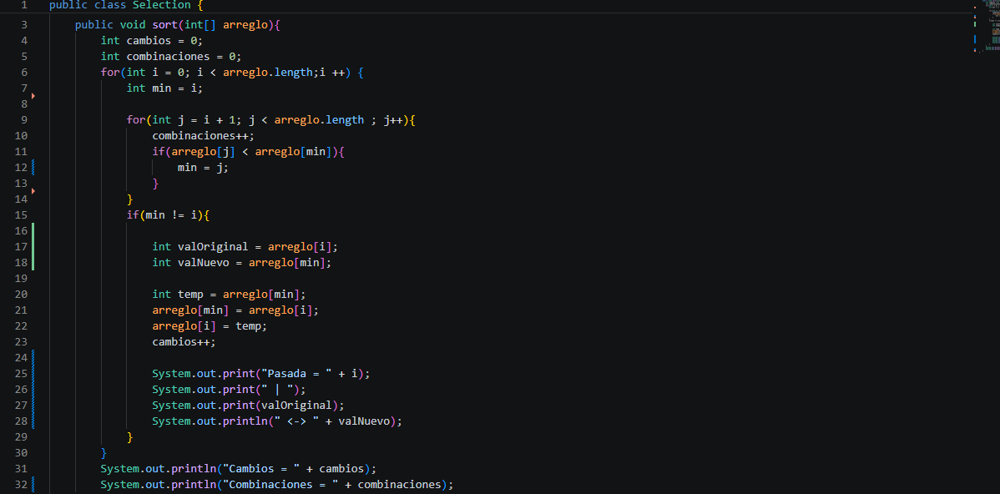
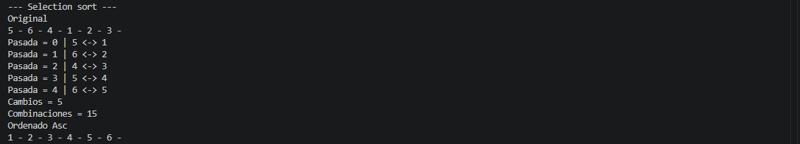

# PC 1.1.2

## EXPLICACIONES 
Para que se muestre los resultados, lo primero que hice fue crea dos variables que contengan los cambios y las combinaciones que se hicieron, tambien creé dos variables mas dentro del if que me permitian tener los datos por el cual se hacia el intercambio e imprimirlos. 

## RESULTADO

