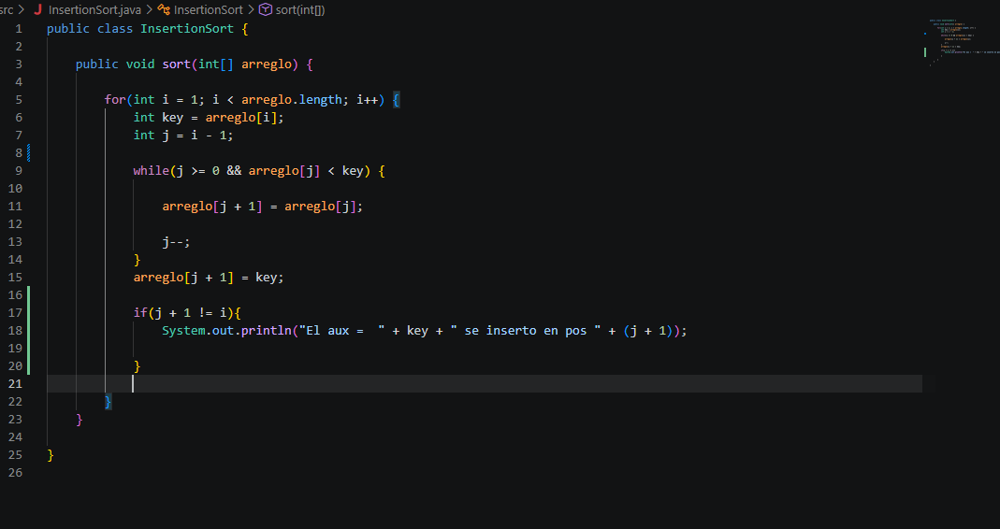
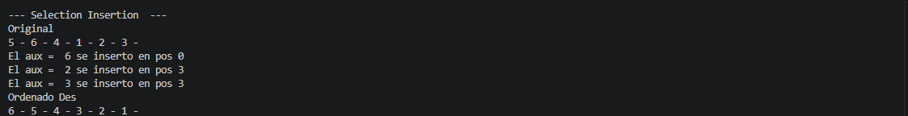

# CODIGO

## Explicacion
Partiendo del codigo que nos ordena acendentemente los numero, cambios el " arreglo [ j ] > key " por " arreglo [ j ] < key " para que nos ordene decendentemente.

Finalmente, agrege un condicional if para que nos muestre en la pantalla unicamente cuando se inserto el numero.

## Resultado

